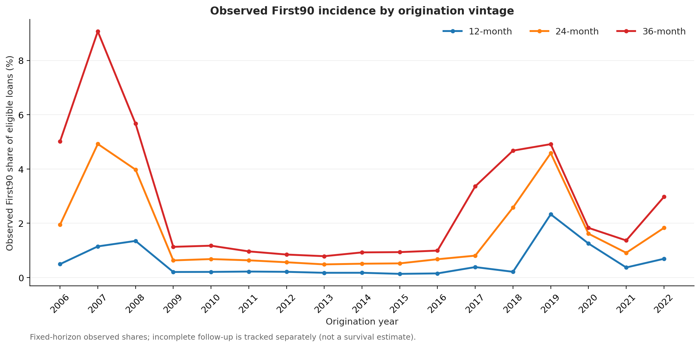
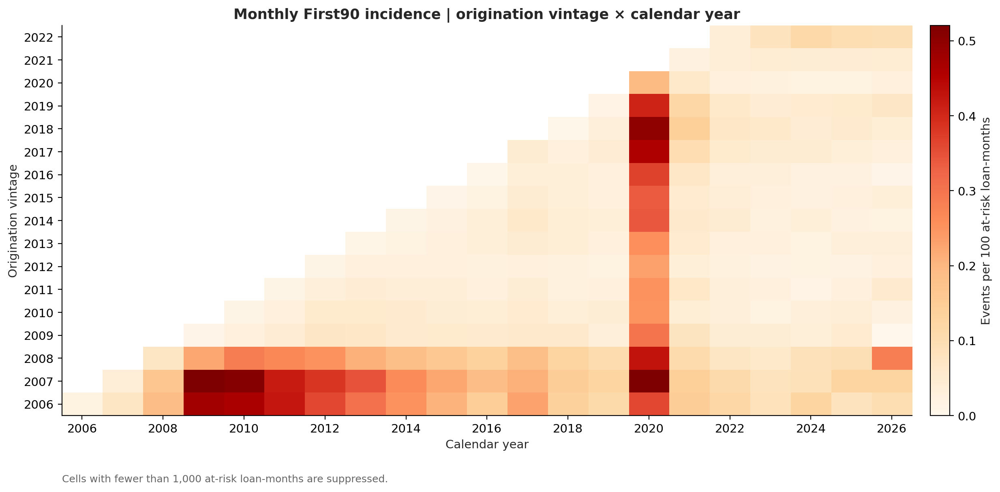
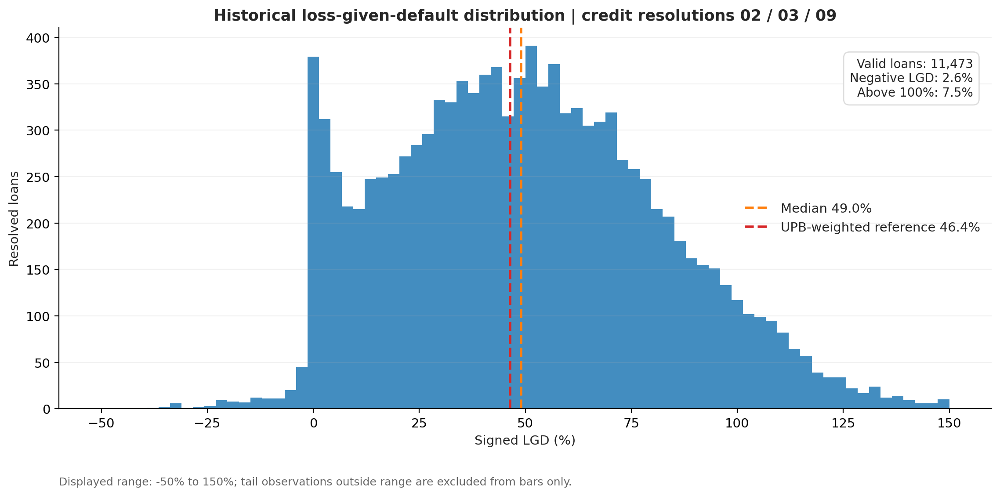

# Credit Portfolio Risk Modeling & Simulation

*From Mortgage Delinquency to Portfolio Risk*

Hi, welcome! 👋

I use Freddie Mac's Single-Family Loan-Level Dataset to study how mortgage delinquency changes over time, build monthly credit-state models, and explore what those predictions mean for portfolio risk. I then connect loan-level credit events with historical loss information, portfolio simulations, and stress scenarios.

The main question is simple: **How does mortgage credit deterioration translate into risk for a loan portfolio?**

**[Read the full report](reports/credit_portfolio_risk_results.md)**

## At a glance

| | Scope |
|---|---|
| **Data** | 850,000 sampled Freddie Mac mortgages; about 51.7 million monthly performance records |
| **Coverage** | 2006–2022 origination vintages |
| **Credit models** | Eight credit states; multinomial logistic benchmark and two state-specific LightGBM variants |
| **Independent validation** | 6,140,535 monthly transitions in the 2021–2022 out-of-time test |
| **Portfolio analysis** | 30,000-loan January 2019 snapshot; 12-month First90 projection and exposure analysis |
| **Risk scenarios** | Historical LGD reference, 10,000 portfolio loss simulations, and parameter stress tests |

## Key findings

- **Independent model validation:** With Macro achieved a lower OOT log loss (**0.12201**), while No Macro more closely matched observed First90 event counts (**O/E = 1.0113**). Different credit-risk objectives favor different evaluation metrics.
- **Mortgage credit behavior:** Vintage, loan age, and calendar-time analyses reveal how observed severe delinquency varies across cohorts and over time.
- **Loss severity:** The audited credit-resolution sample has a **46.45% exposure-weighted historical LGD**, providing a reference for the portfolio loss scenarios.
- **Portfolio tail risk:** In the illustrative simulations, introducing common-factor dependence increases **99% loss VaR from $7.55M to $25.35M**, even though mean losses remain similar.
- **Stress sensitivity:** A combined increase in credit-event probabilities, resolution conversion and loss severity raises the portfolio loss proxy from **$5.64M to $12.66M**.

## 1. Historical mortgage credit behavior

I start by examining **First90**, the first time a mortgage reaches 90+ days past due. The analysis follows different origination vintages over fixed 12-, 24- and 36-month windows, then looks at how delinquency events vary across calendar years.

The vintage view highlights differences in cumulative First90 experience across origination cohorts. The heatmap below adds a calendar-time perspective, using the observed First90 rate per at-risk loan-month.

## 2. Credit-state models and independent validation

I model next-month transitions across eight states: Current, 30–59 DPD, 60–89 DPD, 90+ DPD, Foreclosure, Payoff, Credit Resolution, and Other Exit. I compare a multinomial logistic benchmark with two state-specific LightGBM models, with and without macroeconomic inputs.

**Independent OOT validation.** I test the ten saved LightGBM models on **6,140,535 monthly transitions from 2021–2022**, without retraining or recalibrating them.

| OOT metric | No Macro | With Macro |
|---|---:|---:|
| Multiclass log loss ↓ | 0.12518 | **0.12201** |
| Multiclass Brier score ↓ | 0.04952 | **0.04925** |
| First90 observed / expected (ideal = 1) | **1.0113** | 1.1175 |

The macro-enhanced model has stronger overall multiclass scores, while the non-macro model comes closer to the observed First90 count. I also check results by year and by starting credit state rather than relying on a single aggregate score.

You can find the [development model comparison](reports/figures/model_comparison.png), [eight-state framework](reports/figures/credit_state_framework.png), and [full OOT validation results](reports/task38_oot_validation.md) in the repository.

## 3. Historical loss severity

I audit credit-resolution outcomes and examine **loss given default (LGD)** relative to unpaid principal at the first 90+ delinquency event. The historical exposure-weighted LGD is **46.45%** in the audited resolution sample.

I use the observed distribution and its summary statistics as historical reference information, rather than assuming every resolved loan has the same recovery experience.

## 4. From loan-level PD to portfolio exposure

I use monthly transition probabilities to simulate **12-month First90 probabilities**, then combine those probabilities with outstanding mortgage balances to estimate probability-weighted exposure for a **30,000-loan portfolio as of January 2019**.

To examine the potential financial impact, I combine First90 probabilities, loan balances, a historical First90-to-resolution proportion, and the historical LGD reference.

| Portfolio measure | Result |
|---|---:|
| Outstanding principal balance | **$5.49B** |
| First90-weighted exposure proxy | **$28.42M** |
| Historical First90-to-resolution proportion | **42.74%** |
| Historical exposure-weighted LGD | **46.45%** |
| Historical-reference portfolio loss proxy | **$5.64M** |

The resulting loss measure provides a consistent starting point for comparing portfolio scenarios and sensitivity to credit-risk assumptions.

## 5. Portfolio loss simulation and stress testing

I generate **10,000 portfolio loss scenarios** to compare independent loan-level outcomes with an illustrative common-factor dependence structure.

| Loss scenario | Mean loss | 99% VaR | 99% expected shortfall |
|---|---:|---:|---:|
| Independent events | $5.63M | $7.55M | $7.85M |
| Common factor (assumed parameter = 0.15) | $5.66M | **$25.35M** | **$31.45M** |

The comparison shows why portfolios with similar expected losses can still have very different tail-risk profiles.

I then stress the First90 probability, resolution conversion, and LGD assumptions to measure their effect on the portfolio loss proxy.

The combined parameter stress increases the reference loss proxy from **$5.64M to $12.66M**. This connects model assumptions to results that can be discussed in dollar terms.

## Workflow and tools

| Stage | What I did |
|---|---|
| **Data and audit** | Reconciled mortgage histories, exits, delinquency events, and reported losses |
| **Credit modeling** | Built monthly eight-state transition models with logistic and LightGBM methods |
| **Model validation** | Compared prediction error and event calibration, including independent 2021–2022 OOT tests |
| **Loss analysis** | Audited credit-resolution outcomes and historical LGD |
| **Portfolio risk** | Simulated 12-month First90 paths, aggregated exposures, and analyzed loss scenarios |
| **Stress testing** | Measured sensitivity to credit-event probability, conversion and loss-severity assumptions |

**Tools:** Python, pandas, NumPy, LightGBM, SciPy, Matplotlib, Parquet and Monte Carlo simulation.

[View the analytical workflow](reports/figures/project_workflow.png)

## Where to find things

- [`scripts/`](scripts/) — Data audits, credit models, OOT evaluation, simulations, and reporting scripts.
- [`models/`](models/) — Ten frozen LightGBM boosters and model metadata.
- [`configs/`](configs/) — Feature specifications and model configuration.
- [`reports/figures/`](reports/figures/) — Historical credit analysis, validation and portfolio risk figures.
- [`reports/tables/`](reports/tables/) — Published summary statistics and validation results.
- [`reports/task38_oot_validation.md`](reports/task38_oot_validation.md) — Independent OOT methodology and detailed metrics.
- [`reports/credit_portfolio_risk_results.md`](reports/credit_portfolio_risk_results.md) — Full project results and analytical assumptions.

## Data source and reproducibility

I use the [Freddie Mac Single-Family Loan-Level Dataset (Release 47)](https://www.freddiemac.com/research/datasets/sf-loanlevel-dataset). The repository contains analysis code, saved models, configuration, figures and published results; raw loan-level files are not redistributed.

The **2021–2022 holdout validates monthly credit-state forecasts**. The 12-month simulation and portfolio loss scenarios are separate analyses based on the January 2019 portfolio snapshot and historical risk references. Scenario results are illustrative, not production credit-loss allowances or regulatory capital estimates.

---

Thanks for stopping by! For methods, audit results, and additional diagnostics, take a look at the [full report](reports/credit_portfolio_risk_results.md).
