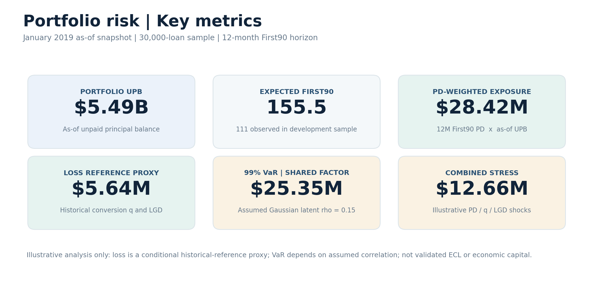
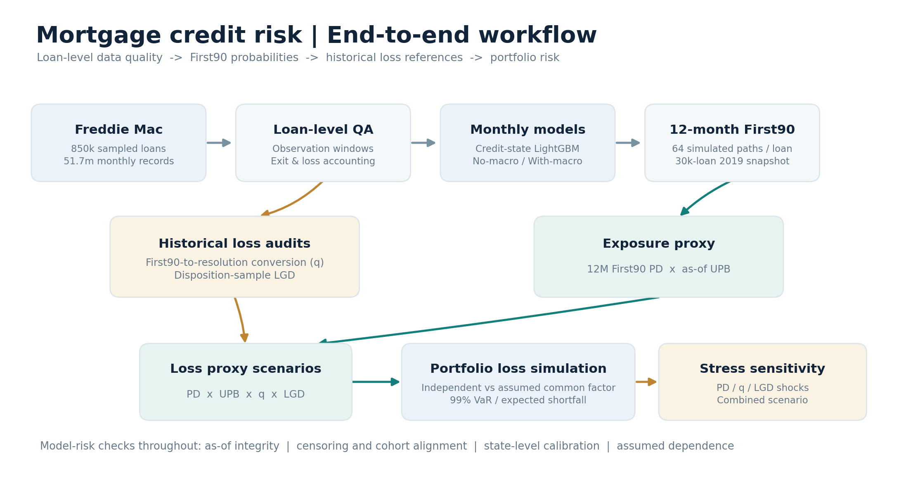
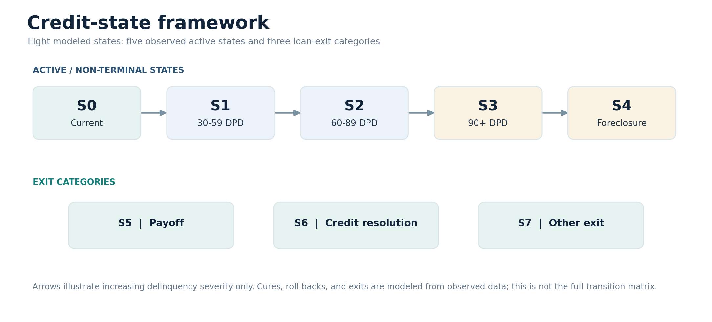
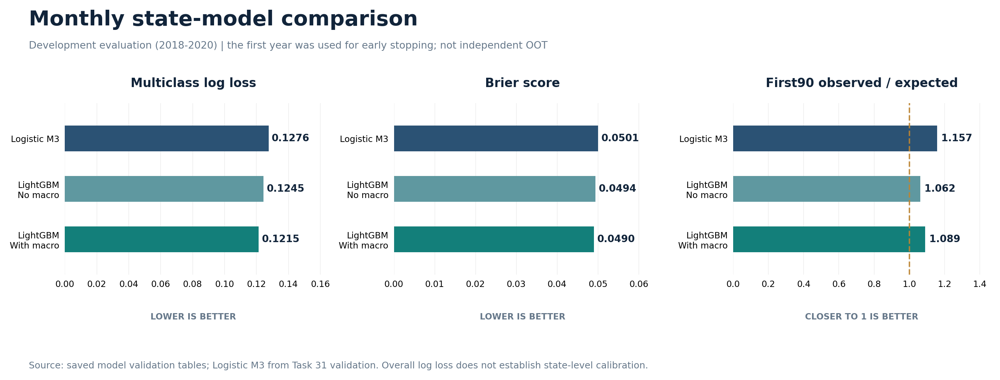

# Credit Portfolio Risk Modeling & Simulation

**Loan-level mortgage credit analytics | PD transition modeling · LGD and data-quality audits · portfolio loss scenarios · model risk**

An end-to-end **credit risk analytics portfolio project** built on the Freddie Mac Single-Family Loan-Level Dataset (Release 47). The objective is to connect loan-level credit-state probabilities with portfolio exposure, historical loss references, tail-risk analysis, and decisions about model reliability—not simply to maximize predictive accuracy.

> **Project status:** Research / analytics prototype for a sampled mortgage portfolio. The loss numbers below are **illustrative conditional proxies**, not validated IFRS 9 / CECL expected credit losses, regulatory capital, or production forecasts.

## Portfolio risk at a glance



| Scope | Description |
|---|---|
| Source | Freddie Mac Single-Family Loan-Level Dataset, Release 47 |
| Historical coverage | 2006–2022 origination vintages |
| Analytical data | **850,000 sampled loans** and approximately **51.7 million monthly performance records** |
| Monthly modeling | State-specific LightGBM; no-macro and macro-enhanced variants |
| Portfolio snapshot | **January 2019**, **30,000 sampled loans** |
| Prediction target | First occurrence of **90+ days past due (First90)** within 12 months |
| Simulation | 64 simulated transition paths per loan; 10,000 portfolio-loss scenarios |

**Business question:** How can a lender translate granular mortgage delinquency dynamics into interpretable portfolio risk estimates—and identify the assumptions most likely to break those estimates?

## End-to-end analytical workflow



This project brings together work usually spread across several credit-risk functions:

1. **Data integrity and event accounting:** observation gaps, time origin, loan exits, First90 definitions, right-censoring, post-default outcomes, and reported losses.
2. **Point-in-time feature construction:** lag-aware state history, loan characteristics, macroeconomic indicators, and temporal integrity checks.
3. **Monthly credit-state modeling:** baseline multinomial models and state-specific LightGBM, with explicit review of calibration and transition-class behavior.
4. **12-month event probability:** simulation of monthly credit trajectories to estimate cumulative First90 probability.
5. **Portfolio loss analysis:** connect First90 PD to as-of balance, historical credit-resolution and loss-given-default references, loss distributions, and sensitivity scenarios.

## Credit-state framework



| State | Meaning | Role |
|---|---|---|
| S0 | Current | Active |
| S1 | 30–59 days past due | Active |
| S2 | 60–89 days past due | Active |
| S3 | 90+ days past due | Active; severe delinquency |
| S4 | Foreclosure | Active modeled state |
| S5 | Payoff | Exit |
| S6 | Credit resolution | Exit |
| S7 | Other exit | Exit |

The figure illustrates the state taxonomy and a severity progression, **not** the full observed transition matrix. The monthly models account for data-supported cures, deterioration, and exits. First90 is an **event definition**, not synonymous with realized charge-off or monetary credit loss.

## Model development and validation



| Model | Monthly log loss ↓ | Brier score ↓ | First90 O/E (target = 1) |
|---|---:|---:|---:|
| Multinomial Logistic (M3) | 0.12760 | 0.05007 | 1.15716 |
| State-specific LightGBM — no macro | 0.12450 | 0.04938 | 1.06243 |
| **State-specific LightGBM — with macro** | **0.12145** | **0.04901** | 1.08942 |

The macro-enhanced LightGBM has the lowest overall log loss and Brier score among these reported development results. **That does not imply every credit transition is well calibrated.** For example, the macro-enhanced model's credit-resolution state (S6) has observed/expected = **0.4109** across the development sample, indicating substantial overprediction of that exit class. The other-exit category (S7) also shows major calibration error.

**Validation boundary:** These metrics cover **2018–2020** development observations; **2018 was used for early stopping**. Results from the reserved independent OOT period are **not reported**. The 12-month First90 assessment on the January 2019 portfolio snapshot produced **155.52 predicted events versus 111 observed**, or **O/E = 0.7137**—an overprediction that should not be hidden behind aggregate discrimination or log-loss metrics.

Saved model artifacts: [`models/nomacro`](models/nomacro) and [`models/withmacro`](models/withmacro). Exact training feature encoding is retained in [`configs/task30_feature_spec.json`](configs/task30_feature_spec.json).

## Connecting PD to portfolio exposure and loss

For loan $i$, the **as-of exposure proxy** is based on the loan's January 2019 outstanding principal balance and its estimated 12-month First90 probability:

$$
\text{First90-weighted exposure} = \sum_i \widehat{PD}_{i,12M}^{\text{First90}} \times UPB_{i,\text{as-of}}.
$$

The historical-reference **eventual loss proxy** further applies a historical First90-to-credit-resolution proportion $q$ and a disposition-sample loss-given-default reference:

$$
\text{Loss proxy} = \sum_i \widehat{PD}_{i,12M}^{\text{First90}} \times UPB_{i,\text{as-of}} \times q_{\text{hist}} \times LGD_{\text{hist}}.
$$

| Historical reference | Value |
|---|---:|
| Eligible historical First90 loans in resolution audit | 24,324 |
| Credit resolutions within the defined 60-month window | 10,396 |
| Historical conversion proportion $q$ | **42.74%** |
| Weighted LGD among the audited disposition sample | **46.45%** |
| Probability-weighted exposure proxy | **$28.42M** |
| Historical-reference loss proxy | **$5.64M** |

**Important:** The historical conversion and disposition LGD references come from **nonidentical audited cohorts**, and current UPB is not default-time EAD. This construction is therefore an analytical **loss proxy**, not a validated 12-month accounting ECL estimate or 12-month loss recognition forecast.

## Portfolio loss distribution and tail sensitivity


Under a historical-reference conversion scenario, **10,000** Monte Carlo portfolio simulations compare independent loan event draws with a common-factor Gaussian structure using an **assumed**, not estimated, latent correlation parameter.

| Assumed latent-factor parameter | Mean loss | 99% VaR | 99% expected shortfall |
|---:|---:|---:|---:|
| 0.00 — independent | $5.63M | $7.55M | $7.85M |
| 0.15 — common factor | $5.66M | **$25.35M** | **$31.45M** |

**Interpretation:** Holding marginal event probabilities and fixed loss severity constant, dependence assumptions materially affect portfolio tail losses. These are **illustrative conditional scenario statistics**, not calibrated default-correlation estimates or validated economic capital requirements.

## Parameter stress sensitivity


| Illustrative assumption shock | Eventual loss proxy | Difference from reference |
|---|---:|---:|
| Historical reference | $5.64M | — |
| First90 PD +25% | $7.05M | +25.00% |
| First90 PD +50% | $8.44M | +49.57% |
| Resolution conversion +25% | $7.05M | +25.00% |
| LGD +20% | $6.77M | +20.00% |
| **Combined parameter stress** | **$12.66M** | **+124.36%** |

These are mechanical **parameter sensitivities**, not forecasts obtained by rerunning the trained PD model under a specified macroeconomic scenario.

## Model risk, assumptions, and limitations

- **Calibration:** Overall performance conceals state-specific miscalibration; the development-sample 12-month First90 prediction overstates observed events.
- **Independent validation:** 2018 served as an early-stopping sample; reserved 2021+ OOT results have not been reported.
- **Exposure definition:** As-of UPB is not actual exposure at the eventual time of default.
- **Historical sample alignment:** Resolution-conversion and LGD references are not fully matched on identical populations and observation windows.
- **Scenario assumptions:** Future macro inputs are held constant during the 12-month PD simulation; loss simulation uses fixed LGD and uncalibrated dependence.
- **Point-in-time leakage risk:** Historical disposition references sourced from a later dataset release may incorporate information unavailable as of January 2019.
- **Sampling:** Equal-size vintage sampling is not a naturally representative mortgage market sample; portfolio aggregate results should not be generalized to the US mortgage market.
- **Scope:** No claim of validated CECL / IFRS 9 allowances, regulatory capital, or production deployment.

For the full discussion of methodology, assumptions, and findings, see **[Credit Portfolio Risk Results](reports/credit_portfolio_risk_results.md)**.

## Repository navigation

| Path | What to look for |
|---|---|
| [`scripts/01_data_inventory.py`](scripts/01_data_inventory.py) – [`scripts/22_lgd_tail_and_visual_audit.py`](scripts/22_lgd_tail_and_visual_audit.py) | Data inventory, observation / default definition, resolution accounting, loss and LGD audits (the numbered scripts between these endpoints) |
| [`scripts/23_pd_target_feasibility_audit.py`](scripts/23_pd_target_feasibility_audit.py) – [`scripts/28_prepare_pd_data.py`](scripts/28_prepare_pd_data.py) | State and target design, feature availability, macro as-of processing, modeling dataset |
| [`scripts/30_full_multinomial_logistic.py`](scripts/30_full_multinomial_logistic.py) | Multinomial credit-state benchmark |
| [`scripts/31_6_state_specific_lgbm.py`](scripts/31_6_state_specific_lgbm.py) | State-specific LightGBM training and development evaluation |
| [`scripts/32_12m_lgbm.py`](scripts/32_12m_lgbm.py) | 12-month First90 path simulation and assessment |
| [`scripts/33_01_exposure.py`](scripts/33_01_exposure.py), [`scripts/33_02_loss_scenarios.py`](scripts/33_02_loss_scenarios.py) | UPB-weighted exposure and conditional loss proxies |
| [`scripts/34_portfolio_loss.py`](scripts/34_portfolio_loss.py) | Dependence-sensitive Monte Carlo loss distribution |
| [`scripts/35_parameter_stress.py`](scripts/35_parameter_stress.py) | Mechanical parameter stress sensitivity |
| [`models/`](models) and [`configs/`](configs) | Ten saved LightGBM boosters, metadata / manifests, and training feature specification |
| [`reports/`](reports) | Detailed written report, charts, and summary tables |

## Running the published artifacts

**Figures and reporting:** The four additional README figures are generated from the released summary tables and model validation metrics, with no raw mortgage records needed:

```bash
python3 -m pip install matplotlib numpy
python3 scripts/37_make_readme_figures.py
```

**Model loading:** Ten LightGBM Booster files and their metadata are included, but rebuilding all intermediate training / evaluation datasets requires access to the original Freddie Mac loan-level data and the project-specific preprocessing outputs. The entire pipeline **cannot be independently rerun from this repository alone**. The published scripts document the analytical steps; some training workflows retain Colab / Google Drive backup assumptions. No trained models need to be refit to display the included summary results or figures.

The public dataset and its applicable terms are available from [Freddie Mac's Single-Family Loan-Level Dataset page](https://www.freddiemac.com/research/datasets/sf-loanlevel-dataset). Raw loan-level records are **not redistributed** in this repository.

---

**Intended audience:** Credit Risk Analytics · Credit Portfolio Risk · Model Risk / Model Validation · Quantitative Risk
