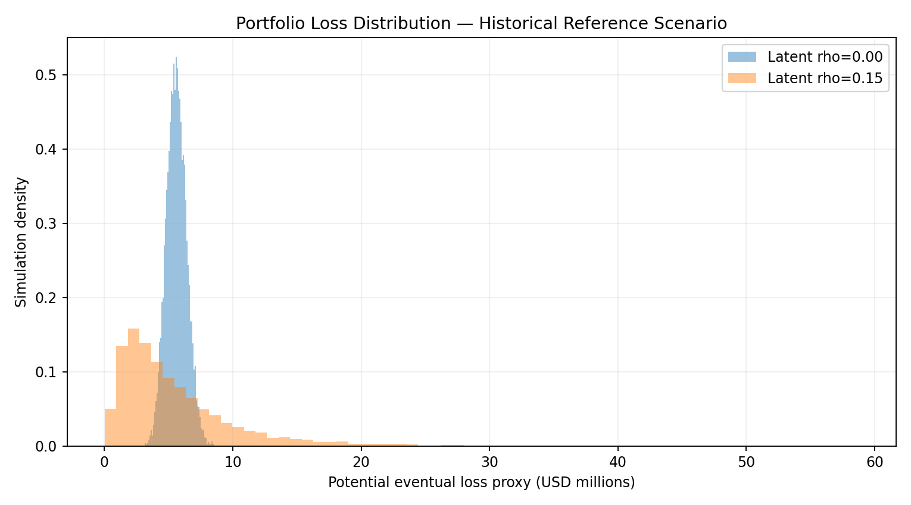
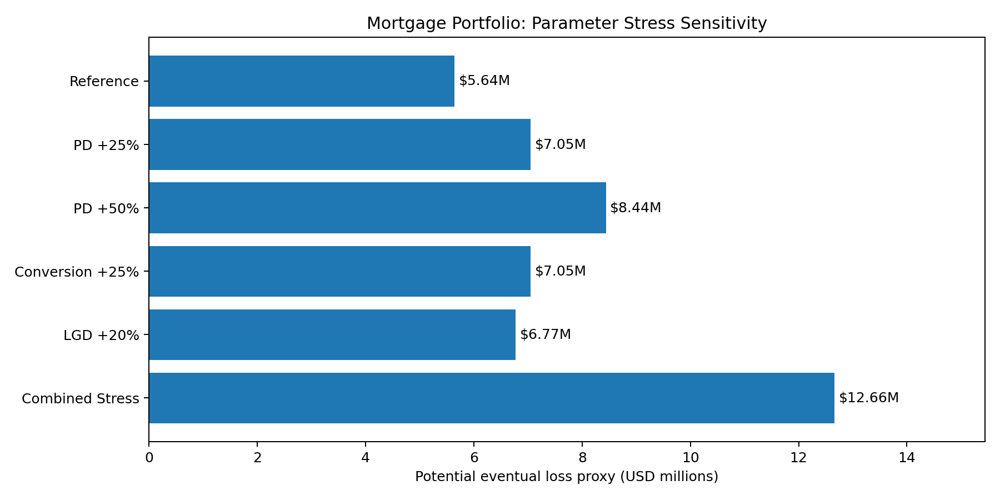

# Credit Portfolio Risk Modeling & Simulation

## Executive Summary

This project develops a loan-level credit risk framework using
Freddie Mac Single-Family Loan-Level Dataset observations.

The analytical pipeline combines monthly credit-state transition
modeling, 12-month cumulative first-90-day delinquency probability,
exposure proxies, historical loss references, Monte Carlo portfolio
loss simulation, and parameter stress sensitivity.

The reported results describe a **30,000-loan development sample
as of January 2019**, not a representative US mortgage market
portfolio or an independently validated production risk system.

## 1. Portfolio and Credit Risk

| Metric | Result |
|---|---:|
| Portfolio snapshot | January 2019 |
| Sample loans | 30,000 |
| Total as-of unpaid principal balance | $5,491.51M |
| Expected first-90+ loans within 12 months | 155.52 |
| Observed first-90+ loans | 111 |
| 12M First90 observed/expected ratio | 0.7137 |
| Probability-weighted first-90+ exposure | $28.42M |

The 12-month First90 predictions are based on a state-specific
LightGBM transition model with 64 simulated paths per loan.

The First90 event is a severe delinquency indicator and should not
automatically be equated with an ultimate realized credit loss.

The development-period 12M probability estimate overpredicts
observed severe delinquency events.

## 2. Historical Credit Loss References

Historical audits provide two reference quantities:

- 10,396 credit resolutions (codes 02/03/09) among 24,324
  eligible historical First90 loans, observed over 60 months.
- Historical exposure-weighted disposition-sample LGD of 46.45%.

The historical First90-to-resolution conversion is approximately
42.74%.

These historical quantities do not come from fully reconciled
identical cohorts. The historical LGD is not a validated prospective
LGD forecast, and the exposure uses January 2019 UPB rather
than default-time EAD.

### Loss Scenario Sensitivity

| Scenario | Conditional conversion assumption | Eventual loss proxy |
|---|---:|---:|
| Lower | 32.05% | $4.23M |
| Historical Reference | 42.74% | $5.64M |
| Higher | 53.42% | $7.05M |

The historical reference loss proxy is **$5.64M**.

This is not a validated IFRS 9 ECL, CECL allowance, or measure of
losses recognized within the next 12 months.

## 3. Portfolio Loss Distribution

10,000 Monte Carlo scenarios are used to compare independent
loan-level events with a hypothetical one-factor Gaussian
dependence structure.

Credit-resolution conversion is modeled conditionally on First90,
and LGD is held fixed at the historical reference.

### Historical Reference Scenario

| Assumed latent-factor rho | Mean loss | Loss standard deviation | 99% VaR | 99% ES |
|---:|---:|---:|---:|---:|
| 0.00 | $5.63M | $0.78M | $7.55M | $7.85M |
| 0.15 | $5.66M | $5.06M | $25.35M | $31.45M |

Introducing a shared risk factor substantially widens the
simulated loss distribution, while the marginal PD-based
analytical expected loss remains unchanged.

The assumed latent-factor rho of 0.15 is not an estimated
mortgage default correlation. The resulting VaR and ES are
illustrative conditional scenario statistics, not validated
economic capital estimates.

## 4. Parameter Stress Sensitivity

The following shocks are illustrative mechanical adjustments
to PD, credit-resolution conversion, and LGD.

They are not produced by re-running the predictive model under
historical or forecast macroeconomic variables.

| Parameter scenario | Eventual loss proxy | Change versus reference |
|---|---:|---:|
| Reference | $5.64M | +0.00% |
| PD +25% | $7.05M | +25.00% |
| PD +50% | $8.44M | +49.57% |
| Conversion +25% | $7.05M | +25.00% |
| LGD +20% | $6.77M | +20.00% |
| Combined Stress | $12.66M | +124.36% |

Under the combined illustrative parameter stress, the potential
eventual loss proxy increases to
**$12.66M**, a
**124.36%** increase
relative to the reference scenario.

## 5. Model Risk and Limitations

1. The First90 model overpredicts the observed development
   sample event count (O/E = 0.7137).
2. The 2018 data were used for LightGBM early stopping and
   cannot be presented as fully independent testing.
3. The reserved 2021-2023 OOT evaluation has not been reported.
4. The 12M path simulator fixes future macroeconomic inputs
   and uses simplified loan-state and balance dynamics.
5. As-of UPB is a proxy, not actual default-time EAD.
6. Historical conversion and LGD estimates are not verified
   on completely aligned cohorts.
7. Loan-level LGD variation and its dependence on the economy
   are omitted from the portfolio simulation.
8. The common-factor dependence parameter is hypothetical,
   not calibrated from historical observations.
9. Parameter stress scenarios are not validated macroeconomic
   stress tests.
10. Historical results based on the latest data release may
    contain information not available at the January 2019
    prediction date.
11. Each origination vintage was sampled at a fixed count,
    so aggregate results should not be generalized to the
    naturally weighted US mortgage market.
12. Simulated risk measures are not regulatory capital,
    accounting provisions, or independently validated forecasts.

## 6. Business Interpretation

The project demonstrates an end-to-end workflow connecting
loan-level credit-state probabilities to portfolio exposure,
conditional loss scenarios, and dependence-sensitive tail risk.

The central lesson is that a point estimate of expected loss
is insufficient for portfolio risk assessment: tail losses
depend materially on joint credit deterioration, loss severity,
and post-delinquency resolution assumptions.

The results are best interpreted as a transparent quantitative
risk analysis prototype with explicit model-risk limitations.

## 7. Reproducibility

The associated scripts and output artifacts should be retained
with their exact versions. The supplied report tables come from
Tasks 33.2, 34, and 35; upstream LightGBM and 12M simulation
results were generated in earlier development tasks.

Raw Freddie Mac data are not included in this report package.
Data access and any redistribution must follow applicable
dataset terms.
