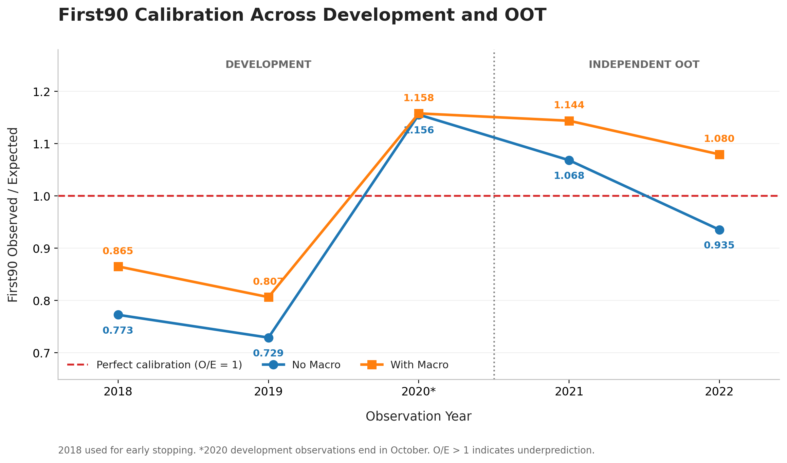
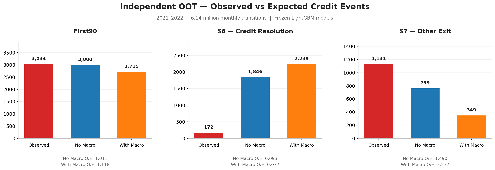

# Task 38 — Independent OOT Validation

## Executive Summary

Ten frozen state-specific LightGBM models were evaluated
on **6,140,535 monthly transitions** from 2021–2022.

The validation used a previously reserved temporal holdout.
No retraining, tuning, recalibration, or OOT-based model
selection was performed.

**Key result:** The macro-enhanced model achieved lower
aggregate multiclass prediction error, while the non-macro
model delivered stronger First90 event-count calibration.

## 1. Development Performance

The development evaluation includes observations from
2018–2020. The 2018 observations were also used for
early stopping, so this period is not an independent holdout.

| Model | Period | Rows | Logloss | Brier | First90 O/E | S6 O/E | S7 O/E |
|---|---|---:|---:|---:|---:|---:|---:|
| No Macro | all | 10,344,541 | 0.12450 | 0.04938 | 1.0624 | 0.4586 | 3.7984 |
| With Macro | all | 10,344,541 | 0.12145 | 0.04901 | 1.0894 | 0.4109 | 5.6463 |

## 2. Independent OOT Performance

| Model | Period | Rows | Logloss | Brier | First90 O/E | S6 O/E | S7 O/E |
|---|---|---:|---:|---:|---:|---:|---:|
| No Macro | all | 6,140,535 | 0.12518 | 0.04952 | 1.0113 | 0.0932 | 1.4898 |
| With Macro | all | 6,140,535 | 0.12201 | 0.04925 | 1.1175 | 0.0768 | 3.2375 |
| No Macro | year_2021 | 3,072,672 | 0.15848 | 0.06504 | 1.0685 | 0.0585 | 1.6626 |
| With Macro | year_2021 | 3,072,672 | 0.15505 | 0.06471 | 1.1440 | 0.0443 | 3.4681 |
| No Macro | year_2022 | 3,067,863 | 0.09183 | 0.03397 | 0.9355 | 0.1875 | 1.2424 |
| With Macro | year_2022 | 3,067,863 | 0.08893 | 0.03376 | 1.0796 | 0.2031 | 2.8718 |

## 3. First90 Event Calibration

Across the 2021–2022 OOT period:

| Metric | No Macro | With Macro |
|---|---:|---:|
| Observed First90 events | 3,034 | 3,034 |
| Expected First90 events | 3,000.07 | 2,714.99 |
| First90 O/E | 1.0113 | 1.1175 |

The non-macro variant demonstrated more accurate aggregate
First90 event-count calibration in the independent holdout.

The annual breakdown is important because aggregated
calibration can conceal offsetting year-level differences.

## 4. State-Specific Calibration

Observed Credit Resolution (S6) events:
**172**

- No Macro expected: 1,845.67
- With Macro expected: 2,239.16

Observed Other Exit (S7) events:
**1,131**

- No Macro expected: 759.18
- With Macro expected: 349.35

The S6 discrepancy is concentrated in transitions
originating from severe delinquency (S3).

S3-to-S6 observations:

- Actual: 105
- No Macro expected: 1,706.15
- With Macro expected: 2,123.78

These findings demonstrate why aggregate model scores
must be complemented by state-specific diagnostics.

## 5. Validation Protocol

- Independent holdout: January 2021–December 2022.
- Target: next-month eight-state transition probabilities.
- Models: five state-specific LightGBM models per variant.
- Training data: historical period through 2017.
- Early stopping: 2018.
- Original feature mapping and model artifacts verified.
- OOT months represented: 24 of 24.
- OOT observations: 6,140,535.
- First90 observed events: 3,034.
- Unseen true transition labels: zero.
- Original multiclass Logloss and Brier definitions retained.
- Original First90 risk-set definition retained.
- No retraining, recalibration, or OOT-based model selection.

## 6. Business Interpretation

The macro-enhanced model provides stronger overall
multiclass probability scores, but the non-macro
variant provides stronger First90 event-count calibration.

The results demonstrate the importance of selecting
model evaluation criteria according to the business
risk event being measured.

State-specific diagnostics identify opportunities
for further investigation of resolution and exit
probabilities before operational use.

## 7. Scope

This exercise evaluates monthly state-transition predictions.
It does not independently test the 12-month path simulator
or downstream portfolio loss scenarios.

Historical macro inputs use lag-aware publication proxies
rather than archived real-time macroeconomic vintages.

The results support a transparent credit-risk analytics
and model-validation prototype.
